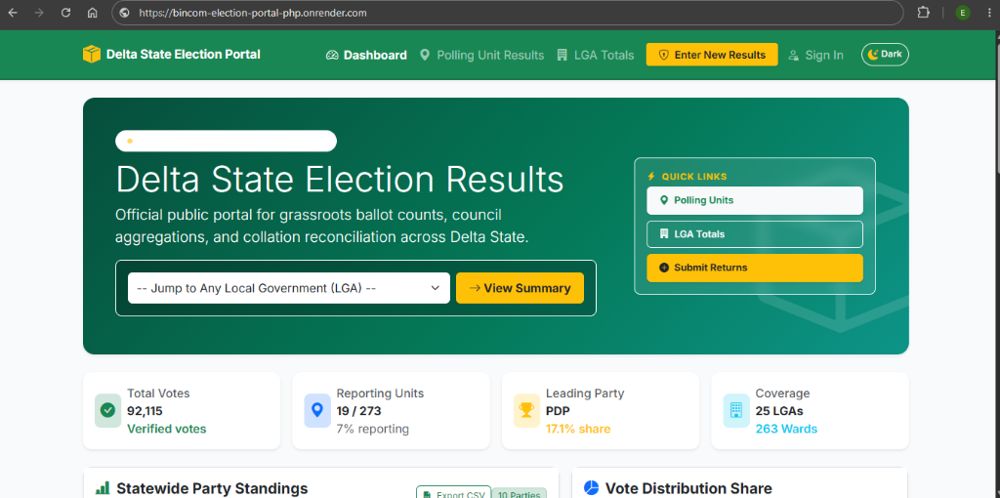

# Bincom ICT Solutions: PHP & MySQL Technical Assessment

An election results collation and reporting portal for the Delta State election dataset, developed using pure PHP and PDO with MySQL as the primary database.

---

## Project Overview

This web application presents the complete solution for the Bincom ICT Solutions technical assessment on the Delta State election records. It allows users to review individual voting center scores, calculate local government council collation totals, and securely record new polling unit returns.

---

## Solutions Implemented

### Question 1: Polling Unit Results Explorer (`polling-unit.php`)
- View certified election scores for any individual voting center across Delta State.
- Filter through three linked dropdown menus: Local Government Area, Ward, and Voting Center.
- Instant search bar to quickly locate voting centers by name, landmark, or electoral code.
- Clear table showing party votes, calculated percentage share, visual progress bars, and an interactive bar chart.
- Displays recorded party agents and presiding officer credentials from the `agentname` table.

### Question 2: Local Government Collation & Audit (`lga-total.php`)
- Calculates and displays the total summed vote count across all voting centers under any chosen Local Government Area.
- Real-time aggregation across the `announced_pu_results` and `polling_unit` tables.
- Interactive doughnut chart highlighting party vote distribution.
- Includes a verification table comparing grassroots voting center totals with announced council figures side by side for audit review.
- Download full council collation data as a spreadsheet (CSV).

### Question 3: Record New Voting Center Results (`new-polling-unit.php`)
- Dedicated data entry page to register a new voting center and record votes for all nine political parties.
- Dynamic ward list that updates automatically when a local council is selected.
- Live tally counter that calculates total votes in real time as scores are typed.
- Captures presiding officer and accredited party representative credentials into the `agentname` table.
- Protected by electoral officer authentication to prevent unauthorized submissions.
- Uses secure database transactions to ensure all records save safely together.

### Statewide Collation Dashboard (`index.php`)
- Summary cards showing total votes recorded, voting centers reported, and leading political parties.
- Interactive directory covering all 25 Local Government Areas.
- One-click CSV export of statewide returns.
- Day and night mode switcher with persistent preference.

---

## Officer Authentication & Security

To prevent unauthorized changes and ensure election integrity, recording new voting center returns (`new-polling-unit.php`) requires authorized officer login:

- **Login Page**: `login.php`
- **Configurable Credentials**: Administrator access is managed through the `ADMIN_EMAIL` and `ADMIN_PASSWORD` environment variables in the hosting dashboard.
- **Session Control**: Authorized officers can sign out at any time using the Sign Out option in the navigation bar (`logout.php`).

---

## Technical Stack & Standards

- **Backend**: Native PHP 8.x with PDO (PHP Data Objects). No external frameworks.
- **Database**: MySQL (`bincom_test`) with complete schema dump (`bincom_test.sql`).
- **Frontend**: Bootstrap 5.3, Bootstrap Icons, and Chart.js.
- **Security**: Prepared statements across all database queries to prevent SQL injection.
- **Access Control**: Session-based administrator authentication for recording new returns.

